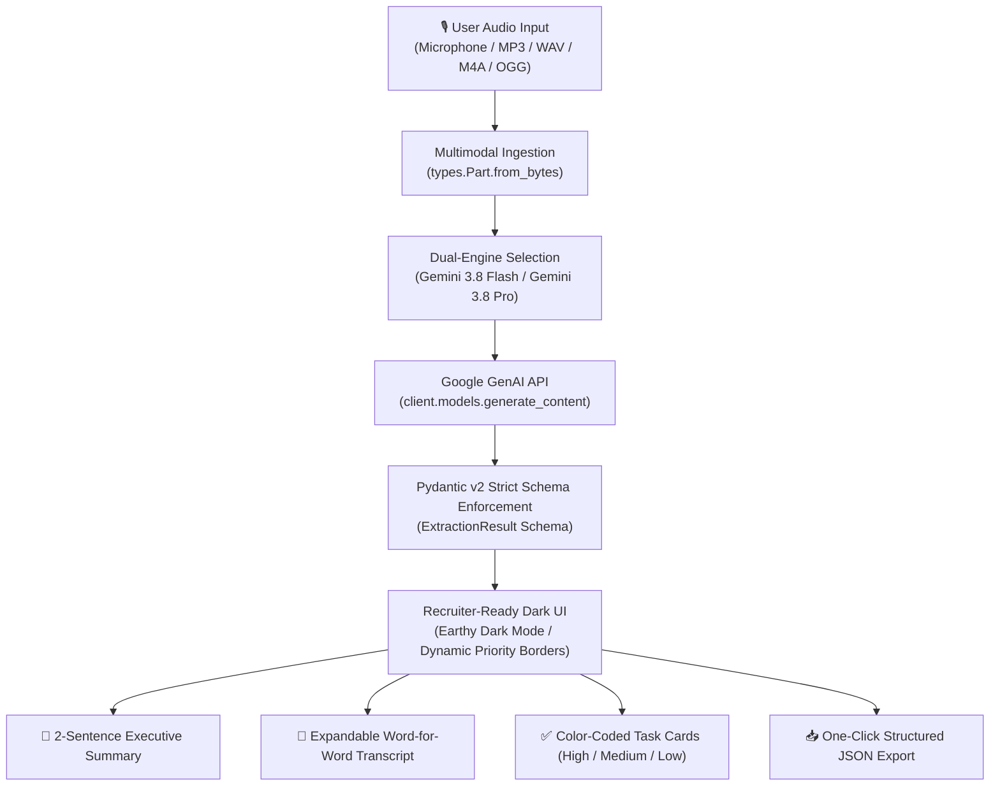

# 🎙️ Voice Notes to Action Items (GenAI Portfolio Edition)

> An enterprise-grade, recruiter-ready Generative AI application that converts unstructured voice recordings into structured, prioritized action items using **Google Gemini 3.8 Flash / Pro** multimodal audio understanding and strict **Pydantic v2** schema enforcement.

[](https://vishal-s-sollapure-voice-notes-to-action-item-app-2kyp2v.streamlit.app/)


---

## 🚀 Live Production Application

- **Live Deployed URL**:  
  👉 **[Voice Notes to Action Items · Streamlit App](https://vishal-s-sollapure-voice-notes-to-action-item-app-2kyp2v.streamlit.app/)**

- **Instant 1-Click Deploy on Streamlit Cloud**:  
  [](https://share.streamlit.io/deploy?repository=vishal-s-sollapure/Voice-Notes-to-Action-Item&branch=main&mainModule=app.py)

> [!TIP]
> **Streamlit Cloud Sleep Mode**: Streamlit Community Cloud automatically puts inactive apps to sleep to conserve free cloud compute. If you see **"Zzzz This app has gone to sleep due to inactivity"**, click the blue button **"Yes, get this app back up!"** on the page. The container will boot up in 15–30 seconds.

---

## 📌 Problem Statement

Spoken voice notes, ad-hoc audio memos, and meeting recordings are full of critical business decisions and tasks. However:
- Manually listening back to lengthy audio is slow and inefficient.
- Traditional pipelines daisy-chain a separate Speech-to-Text (STT) model (e.g. Whisper) with an LLM, causing transcription errors to cascade into extraction inaccuracies.
- Non-deterministic LLM responses often break downstream enterprise integrations due to inconsistent JSON structures.

**Voice Notes → Action Items** eliminates these bottlenecks by utilizing **Google Gemini's native multimodal audio ingestion** combined with **guaranteed Pydantic structured output validation**, delivering accurate transcripts, executive summaries, and prioritized tasks in a single fast inference pass.

---

## 🏗️ System Architecture



---

## ✨ Core Features

1. **Multi-Modal Audio Ingestion**:
   - Live browser-native microphone recording via `st.audio_input`.
   - File upload supporting `.mp3`, `.wav`, `.m4a`, and `.ogg` up to 200MB.
2. **Dual-Engine Model Selection**:
   - `gemini-3.8-flash`: Latest recommended engine, optimized for ultra-fast response times and cost efficiency.
   - `gemini-3.8-pro`: Deep multimodal reasoning for complex, multi-speaker, or jargon-heavy audio.
3. **Native Pydantic Structured Outputs**:
   - Word-for-word audio transcript.
   - Exact 2-sentence executive summary.
   - Strict action items containing task name, assigned owner, deadline, and priority.
4. **Recruiter-Ready Dark Aesthetic**:
   - Earthy dark palette: `#121110` background with `#D4A373` warm bronze accents.
   - Dynamic priority color-coded cards:
     - 🔴 **High Priority**: Crimson Red border (`#E63946`)
     - 🟠 **Medium Priority**: Amber Orange border (`#F4A261`)
     - 🟢 **Low Priority**: Teal Green border (`#2A9D8F`)
5. **Interactive Controls & Export**:
   - Expandable transcript accordion for clean readability.
   - One-click JSON export button (`st.download_button`) for programmatic workflows.
6. **Robust Error Handling**:
   - Real-time status indicators and contextual warnings for quota, audio encoding, or network timeouts.
7. **503 Spike Mitigation & High-Availability**:
   - **Exponential Backoff**: Handles transient `503 UNAVAILABLE` and `429 RATE_LIMIT` spikes with automatic `2^n` backoff retries (2s, 4s, 8s).
   - **Multi-Model Failover**: Automatically switches to alternate models (`gemini-3.8-flash` ➔ `gemini-3.8-pro` ➔ `gemini-2.0-flash`) if any engine encounters sustained congestion.

---

## 📋 Pydantic Type Contract

```python
from enum import Enum
from typing import List, Optional
from pydantic import BaseModel, Field

class PriorityLevel(str, Enum):
    HIGH = "High"
    MEDIUM = "Medium"
    LOW = "Low"

class ActionItem(BaseModel):
    task: str = Field(description="The concise action item or task to be completed.")
    priority: PriorityLevel = Field(description="Priority categorization: High, Medium, or Low.")
    owner: Optional[str] = Field(default="Unassigned", description="Name or role of the person responsible.")
    due_date: Optional[str] = Field(default="Not specified", description="Deadline or timeframe mentioned.")

class ExtractionResult(BaseModel):
    transcript: str = Field(description="Full word-for-word transcript of the spoken recording.")
    executive_summary: str = Field(description="Strictly a 2-sentence executive summary.")
    action_items: List[ActionItem] = Field(description="Array of structured action items extracted from the audio.")
```

---

## 📸 Screenshots

| Clean Audio Ingestion Interface | Processed Action Items & Executive Summary |
|:---:|:---:|
|  |  |

---

## 💻 Local Setup Instructions

### 1. Clone Repository
```bash
git clone https://github.com/vishal-s-sollapure/Voice-Notes-to-Action-Item.git
cd Voice-Notes-to-Action-Item
```

### 2. Configure Virtual Environment
```bash
# Windows
python -m venv venv
.\venv\Scripts\activate

# macOS / Linux
python3 -m venv venv
source venv/bin/activate
```

### 3. Install Requirements
```bash
pip install -r requirements.txt
```

### 4. Provide Gemini API Key
Obtain a free API key at [Google AI Studio](https://aistudio.google.com/). You can provide it directly in the app sidebar or set it in your environment:

```bash
# Windows PowerShell
$env:GEMINI_API_KEY="AIzaSy..."

# macOS / Linux
export GEMINI_API_KEY="AIzaSy..."
```

### 5. Launch the Web Application
```bash
streamlit run app.py
```
Access the application in your browser at `http://localhost:8501`.

---

## ☁️ Deployment Guide

### Streamlit Community Cloud (Recommended)
1. Fork or push this repository to your GitHub account: `https://github.com/vishal-s-sollapure/Voice-Notes-to-Action-Item`
2. Go to [share.streamlit.io](https://share.streamlit.io) and log in with GitHub.
3. Click **"New app"** (or use the 1-Click Deploy badge above).
4. Select `vishal-s-sollapure/Voice-Notes-to-Action-Item`, branch `main`, file `app.py`.
5. Under **Advanced settings ➔ Secrets**, add:
   ```toml
   GEMINI_API_KEY = "your_google_ai_studio_api_key"
   ```
6. Click **Deploy**. Your app will be live at:  
   👉 **[Voice Notes to Action Items · Streamlit](https://vishal-s-sollapure-voice-notes-to-action-item-app-2kyp2v.streamlit.app/)**

### Container Deployment (Docker)
```dockerfile
FROM python:3.12-slim
WORKDIR /app
COPY requirements.txt .
RUN pip install --no-cache-dir -r requirements.txt
COPY . .
EXPOSE 8501
CMD ["streamlit", "run", "app.py", "--server.port=8501", "--server.address=0.0.0.0"]
```

---

## 📂 Project Structure

```text
Voice-Notes-to-Action-Item/
├── app.py                     # Production Streamlit GenAI web application
├── requirements.txt           # Dependency requirements (streamlit, google-genai, pydantic)
├── README.md                  # Comprehensive recruiter-ready documentation
├── screenshot-image.1.jpeg    # Interface screenshot: Audio ingestion & empty state
├── screenshot-image.2.jpeg    # Interface screenshot: Structured task extraction
└── .gitignore                 # Git ignore rules for venv, cache, and secrets
```

---

## 📄 License

Distributed under the [MIT License](LICENSE).
