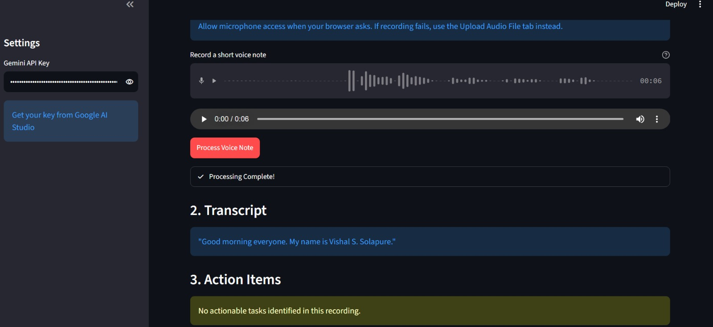
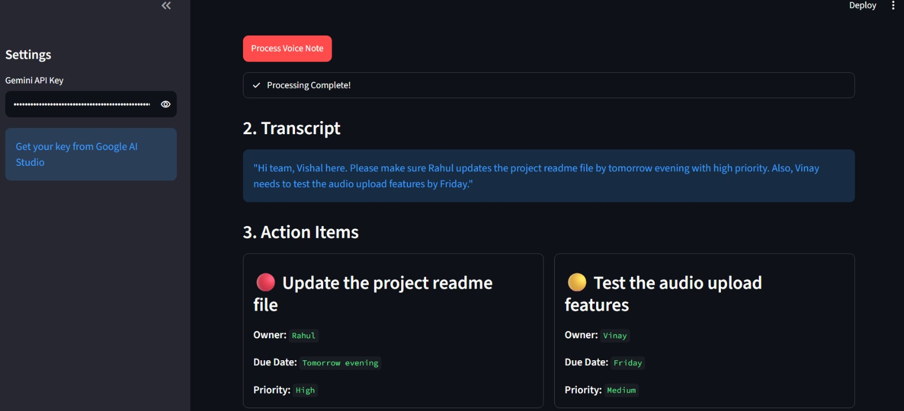

# 🎙️ Voice Notes to Action Items

Turn spoken voice notes and audio recordings into structured, prioritized action items in seconds using **Google Gemini** multimodal AI and **Streamlit**.

[](https://vishal-s-sollapure-voice-notes-to-action-item-app-2kyp2v.streamlit.app/)


---

## 🚀 Live App

- **Live Deployed URL**:  
  👉 **[Voice Notes to Action Items · Streamlit](https://vishal-s-sollapure-voice-notes-to-action-item-app-2kyp2v.streamlit.app/)**

- **Instant 1-Click Deploy on Streamlit Cloud**:  
  [](https://share.streamlit.io/deploy?repository=vishal-s-sollapure/Voice-Notes-to-Action-Item&branch=main&mainModule=app.py)

- **Direct Deployment Template URL**:  
  👉 **[Deploy on Streamlit Community Cloud](https://share.streamlit.io/deploy?repository=vishal-s-sollapure/Voice-Notes-to-Action-Item&branch=main&mainModule=app.py)**

> **Note**: When running on Streamlit Cloud, add your Gemini API key in **App Settings ➔ Secrets**:
> ```toml
> GEMINI_API_KEY = "your-gemini-api-key-here"
> ```

---

## 📌 Problem Statement

Spoken voice notes, voice memos, and meeting recordings often contain critical tasks, but manually listening back to take notes is time-consuming and leads to missed deadlines and untracked assignments. 

**Voice Notes → Action Items** solves this by feeding your raw audio directly to Google Gemini's native multimodal audio model, extracting a word-for-word transcript and structured task cards with assignees, due dates, and priorities.

---

## ✨ Features

- 🎤 **Direct Microphone Recording**: Record voice notes directly from your browser.
- 📁 **Multi-Format Audio Upload**: Supports `.mp3`, `.wav`, `.m4a`, and `.ogg` files.
- 🧠 **Native Multimodal Transcription**: Uses Google Gemini (`gemini-2.5-flash`) for audio comprehension without separate transcription pipelines.
- 📋 **Guaranteed Structured JSON Output**: Extracts tasks using strict Pydantic schemas:
  - **Task Title**: Summary of the action item.
  - **Priority**: Categorized as `High` 🔴, `Medium` 🟡, or `Low` 🟢.
  - **Owner**: Assignee detected from speech, or marked as `Unassigned`.
  - **Due Date**: Deadlines extracted from speech, or marked as `Not specified`.
- 🎨 **Visual Task Cards**: Clean 2-column responsive layout for tasks and full transcript view.
- 🔐 **Flexible Key Handling**: Provide your Gemini API key through the sidebar UI or configure it via `.env` / Streamlit secrets.

---

## 🛠️ Tech Stack

| Component | Technology |
|---|---|
| **Frontend Framework** | [Streamlit](https://streamlit.io/) |
| **Multimodal LLM** | [Google Gemini 2.5 Flash](https://ai.google.dev/) via `google-genai` |
| **Data Validation** | [Pydantic v2](https://docs.pydantic.dev/) |
| **Language** | Python 3.10+ |

---

## 📸 Screenshots

| Empty State UI | Processed Action Items UI |
|:---:|:---:|
|  |  |

---

## 💻 Local Setup Instructions

### 1. Clone the Repository
```bash
git clone https://github.com/vishal-s-sollapure/Voice-Notes-to-Action-Item.git
cd Voice-Notes-to-Action-Item
```

### 2. Create and Activate Virtual Environment
```bash
# Windows
python -m venv venv
.\venv\Scripts\activate

# macOS / Linux
python3 -m venv venv
source venv/bin/activate
```

### 3. Install Dependencies
```bash
pip install -r requirements.txt
```

### 4. (Optional) Set API Key in Environment
```bash
# Windows PowerShell
$env:GEMINI_API_KEY="your-api-key"

# Windows Command Prompt
set GEMINI_API_KEY="your-api-key"

# macOS / Linux
export GEMINI_API_KEY="your-api-key"
```

> If not set in the environment, you can enter the API key directly in the app's sidebar. Get your free key at [Google AI Studio](https://aistudio.google.com/).

### 5. Run the Application
```bash
streamlit run app.py
```
Open your browser at `http://localhost:8501`.

---

## ☁️ Deployment Guide

### Option 1: Streamlit Community Cloud (Recommended)
1. Fork or push this repository to your GitHub account: `https://github.com/vishal-s-sollapure/Voice-Notes-to-Action-Item`
2. Go to [share.streamlit.io](https://share.streamlit.io) and log in with GitHub.
3. Click **"New app"** (or use the 1-click link above).
4. Select repository: `vishal-s-sollapure/Voice-Notes-to-Action-Item`, branch: `main`, file: `app.py`.
5. Under **Advanced settings ➔ Secrets**, add:
   ```toml
   GEMINI_API_KEY = "your_google_ai_studio_api_key"
   ```
6. Click **Deploy**. Your app will be live with your custom public URL, e.g.:  
   👉 **[Voice Notes to Action Items · Streamlit](https://vishal-s-sollapure-voice-notes-to-action-item-app-2kyp2v.streamlit.app/)**

### Option 2: Docker / Container
Create a simple `Dockerfile`:
```dockerfile
FROM python:3.12-slim
WORKDIR /app
COPY requirements.txt .
RUN pip install --no-cache-dir -r requirements.txt
COPY . .
EXPOSE 8501
CMD ["streamlit", "run", "app.py", "--server.port=8501", "--server.address=0.0.0.0"]
```

---

## 📂 Project Structure

```text
Voice-Notes-to-Action-Item/
├── app.py                     # Main Streamlit web application
├── requirements.txt           # Python dependencies
├── README.md                  # Documentation & setup guide
├── screenshot-image.1.jpeg    # UI screenshot
├── screenshot-image.2.jpeg    # UI screenshot
└── .gitignore                 # Git ignore configuration
```

---

## 📄 License

This project is open source and available under the [MIT License](LICENSE).
